<a href="https://fundamentals.dhaf.in">fundamentals.dhaf.in</a> &nbsp;·&nbsp; <a href="https://invitasi.app">invitasi.app</a> &nbsp;·&nbsp; <a href="https://folink.app">folink.app</a> &nbsp;·&nbsp; <a href="https://devault.dhaf.in">devault.dhaf.in</a> &nbsp;·&nbsp; <a href="https://linkedin.com/in/dhafin">linkedin</a> &nbsp;·&nbsp; <a href="mailto:dhiodhaha@gmail.com">dhiodhaha@gmail.com</a>

